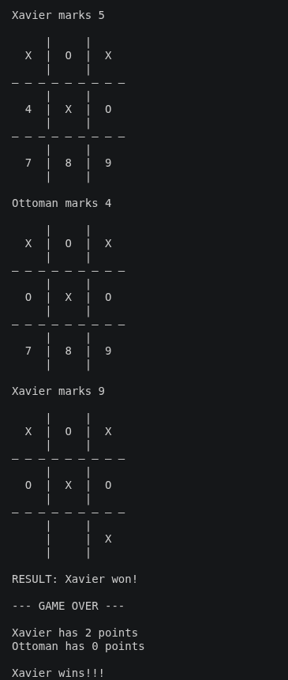

# tic-tac-toe
A terminal-based [Tic Tac Toe](https://en.wikipedia.org/wiki/Tic-tac-toe) (or "X and O") game for two players playing against each other.

### Check it out yourself

1. Make sure you've got [Ruby installed on your local machine](https://www.theodinproject.com/lessons/ruby-installing-ruby). 

2. Clone this repo.

3. Run

```ruby
bundle install
```

to install dependencies automatically.

4. Run

```ruby
bundle exec ruby main.rb
```

to play the game!

### Screenshot

Here's a screenshot of the end of gameplay after 2 rounds:


